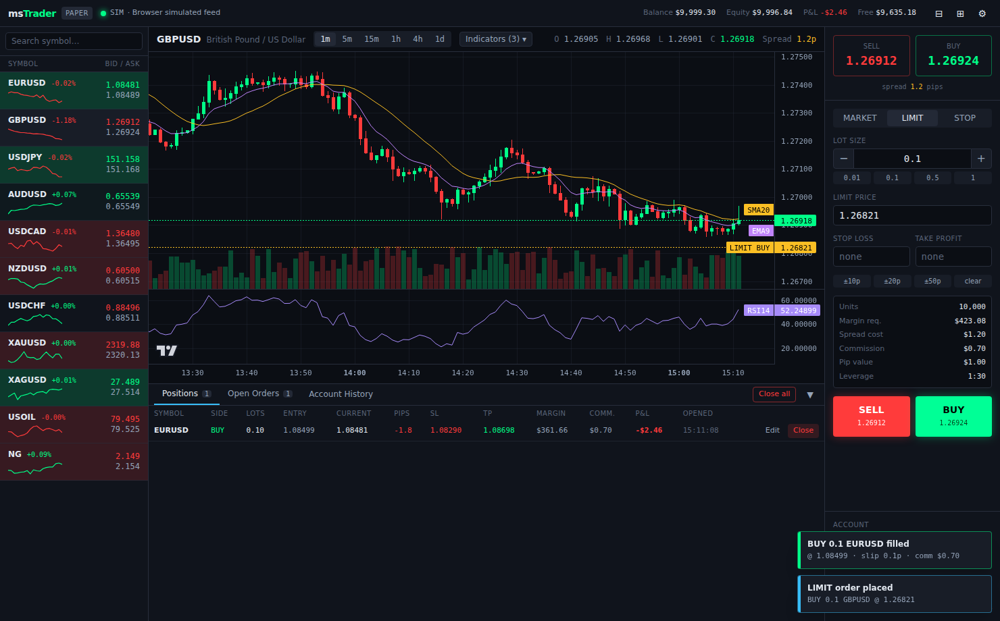

# msTrader

Professional desktop Forex paper-trading terminal. **Live market data, dummy money.**

Built with Electron + React 19 + TypeScript, Tailwind CSS, Zustand, TradingView
Lightweight Charts v5 and SQLite (better-sqlite3).



## Features

- **Live prices** from OANDA v20 (tick-level HTTP stream, free demo account) with
  automatic failover to Yahoo Finance polling, and an optional clearly-labelled
  simulated feed when fully offline. Source and health are always shown in the header.
- **Paper trading engine** with realistic costs: bid/ask spread, size-dependent
  slippage, per-lot commission, leverage-based margin, margin level and 50% stop-out.
- **Order types**: Market, Limit, Stop · Stop-loss / Take-profit on every order,
  editable on open positions.
- **Instruments**: EURUSD, GBPUSD, USDJPY, AUDUSD, USDCAD, NZDUSD, USDCHF,
  XAUUSD, XAGUSD, USOIL, NG — provider tickers mapped centrally in `shared/instruments.ts`.
- **Charting**: candlesticks + volume, 1m–1d timeframes, SMA/EMA overlays, RSI pane
  (computed in a Web Worker), entry/SL/TP/pending-order price lines.
- **Persistence**: closed trades, open positions, pending orders, balance and settings
  are stored in a local SQLite database (`<userData>/mstrader.db`).
- **UX**: dark / light / auto theme, sound alerts, in-app toasts + native OS
  notifications, system tray, collapsible panels, responsive down to ~900px.

## Getting started

```bash
pnpm install          # also rebuilds better-sqlite3 for Electron
pnpm dev              # Electron + Vite with HMR
pnpm dev:web          # renderer only, in a browser tab (simulated feed)
pnpm test             # vitest unit tests (pricing, indicators)
pnpm typecheck
pnpm build            # production bundle in out/
pnpm dist             # installers via electron-builder (release/)
```

### Live data (recommended)

1. Create a free OANDA **practice** account and generate a v20 API token.
2. In msTrader open **Settings → Market data** and paste the token + account ID.

Without credentials the app polls Yahoo Finance (~15 s delayed, no key needed).
If that also fails and *Allow simulated feed* is on, a random-walk feed is used
and the header badge reads **SIM**.

## Project structure

```
msTrader/
├── package.json
├── electron.vite.config.ts      # main / preload / renderer bundles
├── vite.browser.config.ts       # renderer-only dev (pnpm dev:web)
├── vitest.config.ts
├── tailwind.config.cjs · postcss.config.cjs
├── tsconfig.json · tsconfig.node.json · tsconfig.web.json
├── db/
│   └── schema.sql               # SQLite tables (users, accounts, trades, …)
├── shared/                      # code compiled into BOTH processes
│   ├── types.ts                 # Tick, Candle, Position, TradeRecord, AppSettings…
│   ├── instruments.ts           # master instrument table + provider ticker map
│   ├── ipc.ts                   # IPC channel names
│   └── api.ts                   # window.mstrader bridge contract
├── electron/                    # main process
│   ├── main.ts                  # window, tray, IPC handlers, tick batching
│   ├── preload.ts               # contextBridge → window.mstrader
│   ├── database.ts              # better-sqlite3 repository
│   └── feeds/
│       ├── base.ts              # PriceFeed interface
│       ├── oanda.ts             # OANDA v20 pricing stream + candles
│       ├── yahoo.ts             # Yahoo Finance polling fallback (local proxy)
│       ├── sim.ts               # last-resort simulated feed
│       └── manager.ts           # failover chain OANDA → Yahoo → SIM
└── src/                         # renderer (React)
    ├── index.html · main.tsx · index.css
    ├── App.tsx                  # grid layout: watchlist | chart/bottom | order panel
    ├── components/
    │   ├── Chart.tsx            # lightweight-charts v5, indicators, price lines
    │   ├── Watchlist.tsx        # prices, % change, sparklines
    │   ├── OrderPanel.tsx       # ticket + cost preview + account summary
    │   ├── BottomPanel.tsx      # Positions / Open Orders / Account History
    │   ├── Header.tsx · SettingsModal.tsx · Toasts.tsx
    ├── hooks/
    │   └── useMarketData.ts     # feed bootstrap, stale watchdog, candle aggregation
    ├── store/
    │   ├── tradeStore.ts        # paper-trading engine (Zustand)
    │   ├── marketStore.ts       # quotes, sparklines, selection
    │   ├── settingsStore.ts · uiStore.ts
    ├── lib/
    │   ├── pricing.ts           # P&L, margin, slippage, spread, commission
    │   ├── indicators.ts        # SMA / EMA / RSI
    │   ├── format.ts · sound.ts
    ├── services/bridge.ts       # Electron bridge or in-browser shim
    └── workers/indicator.worker.ts
```

## Architecture notes

- **Data flow**: `FeedManager` (main) → coalesced per-frame IPC batch →
  `marketStore.applyTicks` (quotes) and `tradeStore.onTicks` (P&L, SL/TP,
  pending-order triggers, stop-out). The renderer never calls a market API directly.
- **OANDA "WebSocket"**: OANDA v20 streams prices over a long-lived chunked HTTP
  response (newline-delimited JSON), not a WebSocket. `OandaFeed` consumes it with
  the Fetch streaming API, a 15 s heartbeat watchdog and exponential-backoff reconnects.
- **Costs**: commission is debited at open; spread is implicit in bid/ask fills;
  slippage is a size- and spread-regime-dependent adverse move (see `lib/pricing.ts`).
- **Persistence**: writes are debounced (500 ms) and batched in a transaction.

## Trading math

| Instrument | Contract | Leverage | Commission (RT / lot) |
|-----------|----------|----------|------------------------|
| FX majors | 100,000  | 1:30     | $7                     |
| XAUUSD    | 100 oz   | 1:20     | $0                     |
| XAGUSD    | 5,000 oz | 1:20     | $0                     |
| USOIL     | 1,000 bbl| 1:10     | $0                     |
| NG        | 10,000 MMBtu | 1:10 | $0                     |

P&L for USD-quoted symbols = Δprice × units; for USD-based pairs (USDJPY…) the
quote-currency P&L is converted at the exit price.
